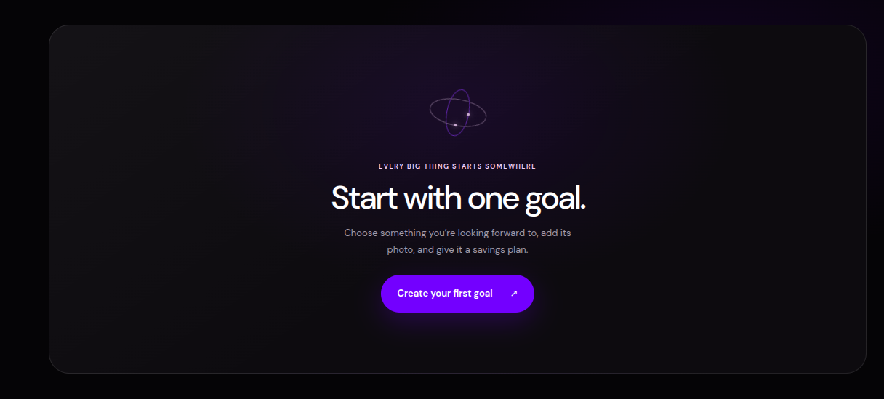
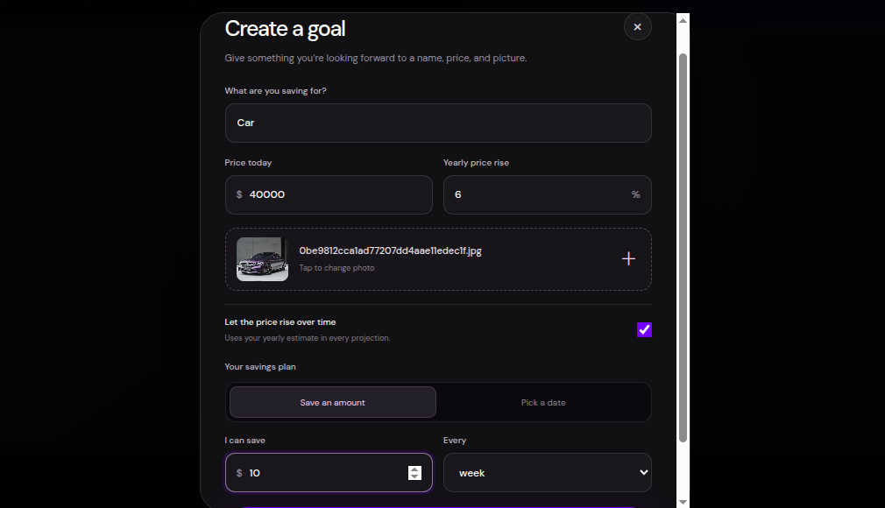
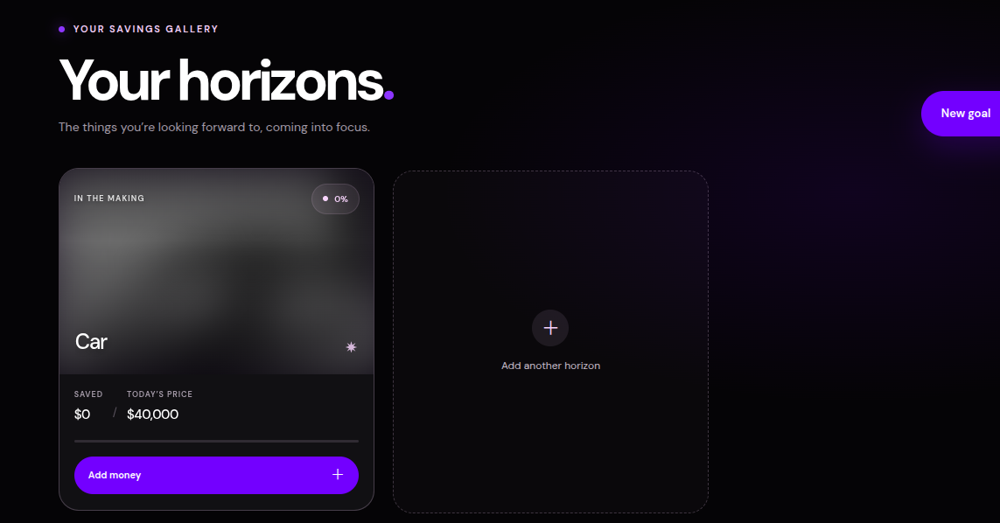
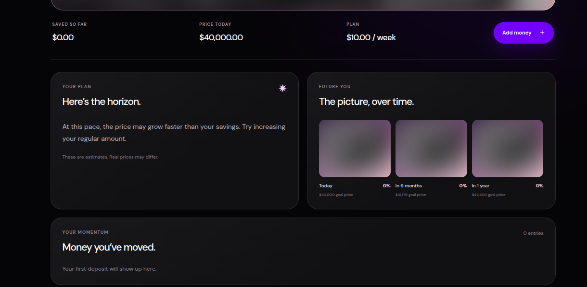
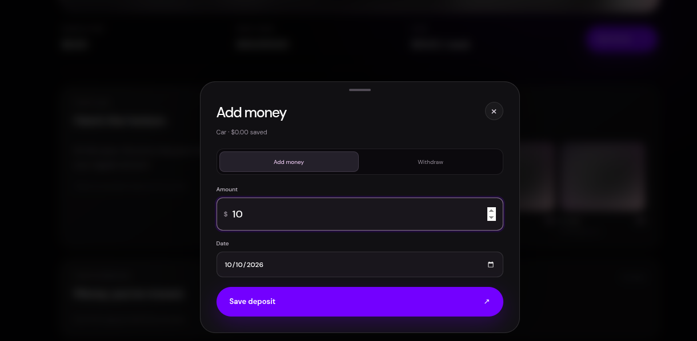
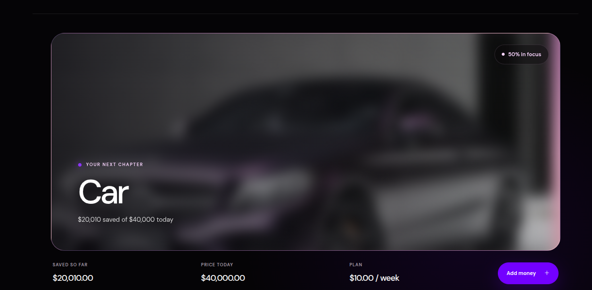

# On the Horizon

On the Horizon is a visual savings-goal app. Instead of treating progress as only a balance or bar, it uses the goal photo itself: the picture begins blurred and grayscale, then becomes clearer and more colorful as savings grow.

The prototype is intended for personal planning and motivation. It does not hold, transfer, invest, or sync money. Goals, photos, and manually entered transactions stay in the current browser.

## Tech stack

- **React** for the interface and interactive goal flows.
- **Vite** for local development and production builds.
- **Tailwind CSS** plus project CSS for styling and responsive layouts.
- **Browser `localStorage`** for goals, plans, photos, and transaction history.
- **Canvas API** to resize uploaded images to at most 900 pixels on the long side and save them as compressed JPEGs.
- **CSS filters** to derive image blur and grayscale from current savings progress.

There is no backend service in this prototype. The `backend/` folder is reserved for future API and sync work.

## Run the app

Use Node.js and npm, then run these commands from the frontend folder:

```bash
cd frontend
npm install
npm run dev
```

Open the local address Vite prints in the terminal, usually `http://localhost:5173`.

To create and preview a production build:

```bash
npm run build
npm run preview
```

Run both commands from `frontend/`.

## How to use it

1. Choose **Create your first goal** and enter a goal name and its price today.
2. Upload a photo. It is resized in your browser before being saved.
3. Set an optional yearly price increase, then choose either a regular saving amount or a target date.
4. Open a goal from the gallery to see its projection and photo previews for today, six months, and one year ahead.
5. Use **Add money** to record a deposit or withdrawal with its date. The gallery photo and progress update from the transaction history.
6. Choose **Reset app data** in the dashboard footer to remove all saved goals, photos, and transaction history from this browser.

Progress is calculated from saved deposits minus withdrawals, divided by the goal's projected price today. Blur and grayscale are derived from that percentage; they are not stored. Projections are estimates, and the default yearly increase is an editable placeholder.

## App screenshots

### 1. Empty dashboard



### 2. Create a goal



### 3. Savings gallery



### 4. Plan projection and future photo previews



### 5. Add money



### 6. Goal detail photo



## Visual references

### Mobile wealth app layout inspiration


### Typography inspiration: DM Sans and star mark


### Color inspiration: lilac, violet, black, and white


## Project structure

```text
frontend/       React + Vite app
backend/        reserved for a future API
inspo UI/       visual reference screenshots
screenshots/    screenshots included in this README
BUILD_PLAN.md   one-night implementation plan
```
